# Enginuity Architecture

Enginuity is a browser-based robotics engineering workspace: describe a task, construct a cell, evaluate motion, simulate execution, and export controller-native programs.

The application is a **modular monolith**, not a collection of independently deployed microservices. A Next.js Node process owns the authoritative workspace and engineering execution. The browser maintains a synchronized view; isolated runtime instances and Python child processes provide specialized execution.

## Architecture at a glance

| Surface | Implementation |
| --- | --- |
| Engineering capability | **293 registered commands: 283 public tools and 10 internal commands** |
| Public tool organization | **36 namespaces**, grouped into **12 command categories** |
| Public command metadata | **84 read-only tools**; one detached command, `script.run` |
| Interactive studio | React 19, Next.js 16, Zustand, React Three Fiber, Three.js, drei |
| Authoritative execution | Shared server workspace, serialized command queue, Zod validation, transactions and undo |
| Numerical kernels | Rust compiled to WebAssembly: `rc_core` and `rc_cad` |
| Physical simulation | Deterministic Rapier runtime on the server |
| Copilot | Agents SDK orchestration, Meta Model API, optional web grounding and SAM 3.1 |
| Automation interfaces | HTTP commands, HTTP MCP, stdio-to-HTTP MCP bridge, binary TCP automation API |
| Code execution | Bounded QuickJS runtime; separately launched CPython processes |
| Persistence | Filesystem-backed settings, geometry, stations, backups, programs, exports and approvals |

Counts describe the loaded command registry, not a count of HTTP routes, TCP verbs, Python methods, or model calls. Optional runtime services and hardware-related operations can report unavailable capabilities.

## 1. C4 system context

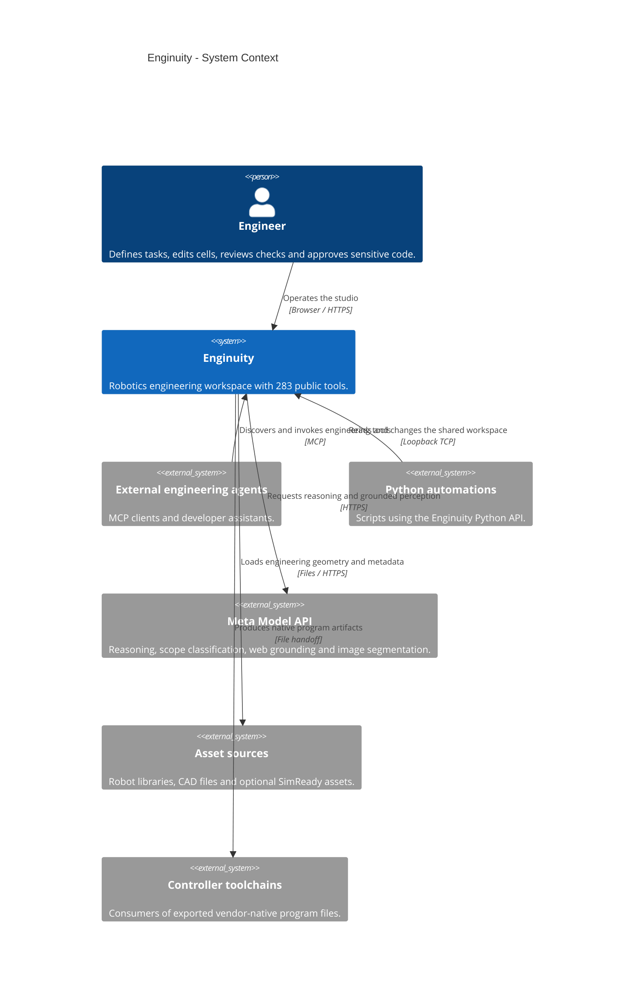

The controller relationship is an **artifact handoff**, not a claim of direct physical execution. A successful simulation or export does not replace hardware commissioning.

## 2. C4 containers and process boundaries

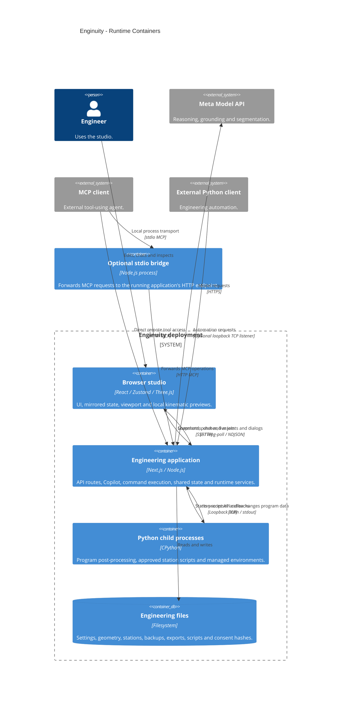

The Python box is a process boundary, not a separate service deployment. The stdio bridge does not create a second workspace; it connects to an existing application.

## 3. C4 server components

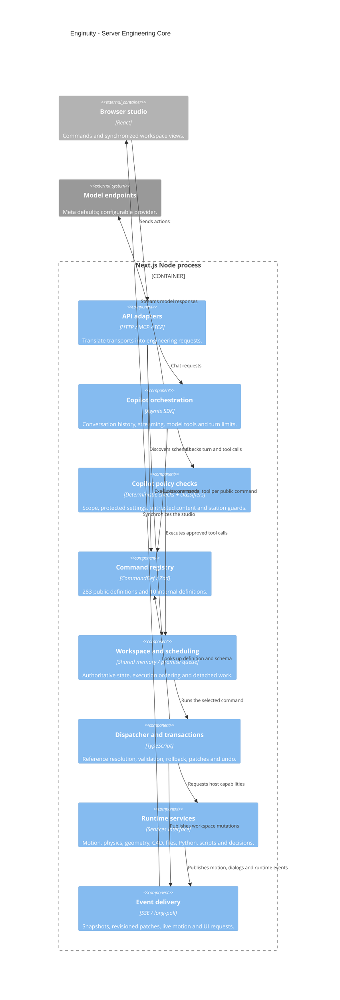

### Command contract

Each `CommandDef` carries a name, title, description, category, Zod schema and execution function. Metadata includes `readonly`, `undoable`, `internal`, `detached`, shortcut and optional specification fields.

Execution receives a `CmdCtx` containing the workspace, transaction, origin and host services. Origins are `ui`, `api`, `agent` and `system`; they are provenance and policy inputs, **not user identities or tenant isolation**.

Ordinary commands share one promise queue. `script.run` is detached so its asynchronous host calls can re-enter that queue without deadlocking it.

## 4. Where computation actually happens

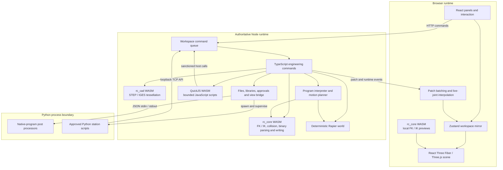

- **Browser:** renders a mirror and performs local preview calculations. It is not the authority for station mutations.
- **Core WASM:** shared numerical implementation loaded from disk by Node and fetched by the browser.
- **CAD WASM:** server-side import service; creates a fresh instance per import and cooperatively yields during processing.
- **Physics:** server-side fixed-step runtime; the browser renders the results rather than advancing a separate authoritative physics world.
- **QuickJS:** runs in-process through WebAssembly, with bounded memory, duration and host-call count.
- **Python:** runs in child processes. Isolated import flags and hash-based approval do not constitute an operating-system sandbox.

These are mostly in-process components. CPU-heavy work is not automatically offloaded to a distributed worker fleet.

## 5. The 283-tool capability surface

### One registry, three discovery surfaces

`GET /api/commands` publishes the public command definitions and JSON schemas. Copilot builds one function tool per public definition. MCP builds one MCP tool per public definition, with read-only and destructive-operation annotations.

Command names such as `program.addMoveJ` become model/MCP names such as `program_addMoveJ`. There is **not** a separate small discovery/run facade hiding the 283 tools.

Optional `web_search` and `photo_findObjects` are Copilot helpers **in addition to** the engineering registry. Guard-model calls are implementation details, not additional engineering tools. The binary TCP API has its own verb registry and is not included in the 283 count.

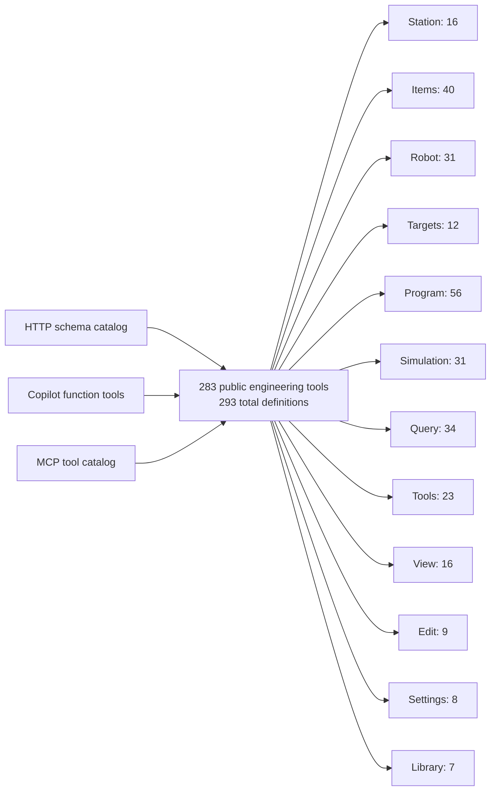

The diagram uses the registry's **categories**. Categories and command-name namespaces are different dimensions: for example, a namespace can contribute commands to several categories.

### Complete public namespace inventory

| Namespace | Tools | Main responsibility |
| --- | ---: | --- |
| `calib` | 2 | Calibration workflows |
| `camera` | 6 | Virtual camera configuration |
| `collision` | 8 | Pair filtering and movement/collision checks |
| `decision` | 5 | Decision-service configuration and execution |
| `edit` | 9 | Selection, editing and undo workflows |
| `event` | 1 | Event-related workspace operations |
| `examples` | 2 | Example-cell discovery and loading |
| `file` | 2 | File-oriented workspace operations |
| `folder` | 1 | Folder creation |
| `frame` | 1 | Reference-frame creation |
| `help` | 1 | Engineering help and discovery |
| `instruction` | 17 | Program instruction editing |
| `io` | 2 | Simulated input/output |
| `iso` | 2 | Accuracy-analysis workflows |
| `item` | 21 | Common scene-item operations |
| `library` | 4 | Robot and asset discovery/loading |
| `machining` | 9 | Machining-project preparation and generation |
| `mechanism` | 2 | Mechanism construction |
| `object` | 27 | Geometry, curves and object manipulation |
| `physics` | 6 | Physical bodies and simulation control |
| `post` | 6 | Postprocessor discovery, configuration and approval |
| `program` | 23 | Motion programs, validation, execution and generation |
| `python` | 10 | Python code, execution and approval |
| `robot` | 41 | Robot setup, joints, kinematics and motion |
| `script` | 7 | Bounded JavaScript automation |
| `settings` | 3 | Application configuration |
| `sim` | 9 | Simulation state and runtime control |
| `simready` | 3 | Prepared physical-asset discovery and loading |
| `spray` | 5 | Spray and deposition simulation |
| `station` | 15 | Workspace/station lifecycle and serialization |
| `target` | 15 | Joint and Cartesian targets |
| `tool` | 2 | Robot-tool creation and handling |
| `utilities` | 1 | Engineering utilities |
| `view` | 13 | Camera, display and view operations |
| `vr` | 1 | VR-related capability surface |
| `workspace` | 1 | Workspace description |
| **Total** | **283** | **36 public namespaces** |

Ten internal commands support runtime bookkeeping and are hidden from public REST discovery, Copilot tool construction and MCP tool listing. Tool registration does not by itself imply that an optional service or physical device is configured.

## 6. Sequence: UI command, transaction and synchronization

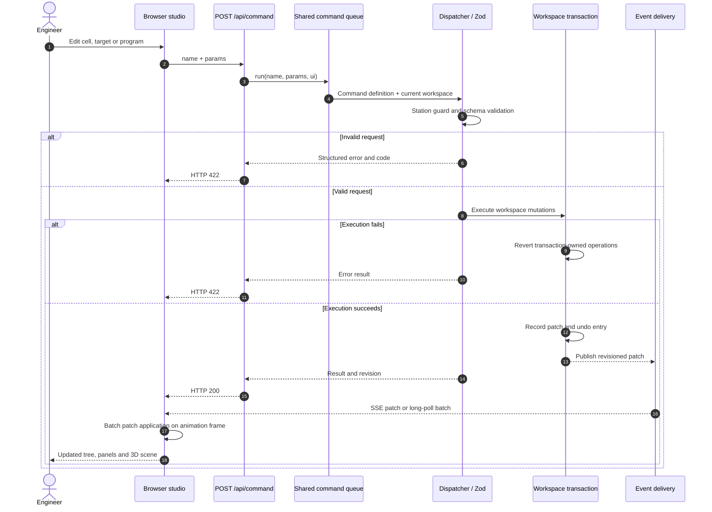

Server patch delivery is coalesced at roughly 150 ms. Browser application is batched with animation frames. Live-joint events have a separate interpolation/rendering path so motion does not require a full workspace patch for every frame. SSE has a long-poll fallback.

Transactions cover recorded workspace mutations; they are not a universal rollback mechanism for arbitrary filesystem or process side effects.

## 7. Sequence: agentic engineering loop

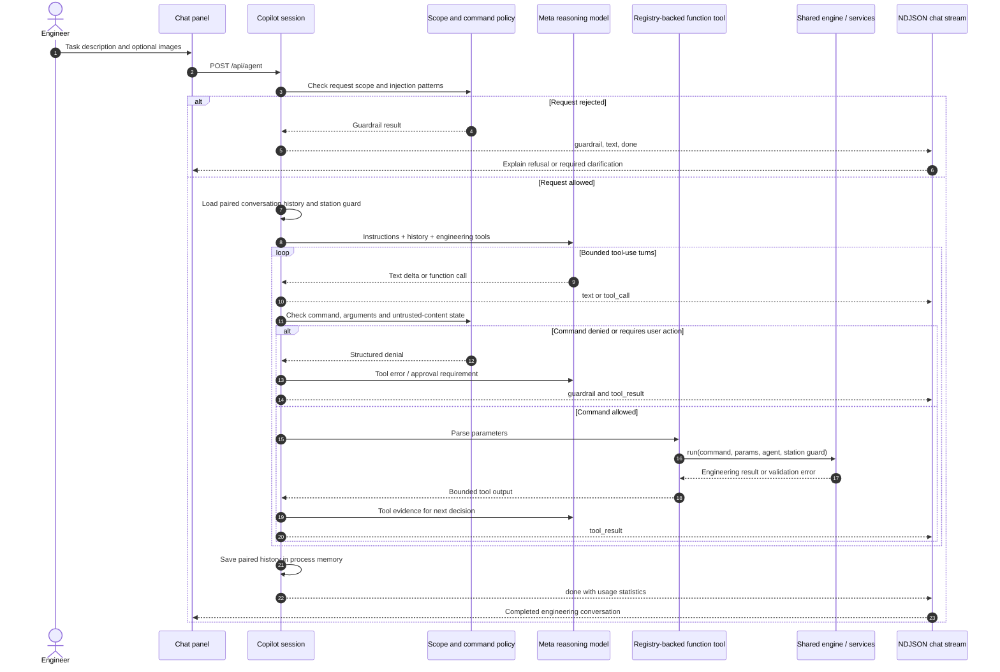

The reasoning model defaults to `muse-spark-1.3`. The orchestration supports configurable providers and models; Meta is the default endpoint. The runner bounds a request to 60 turns. Switching the active station during a guarded agent operation produces a station-change error rather than silently acting on the new station.

The chat endpoint streams **NDJSON**, not SSE. Workspace synchronization uses the separate SSE/long-poll channels.

## 8. Sequence: MCP and Python automation

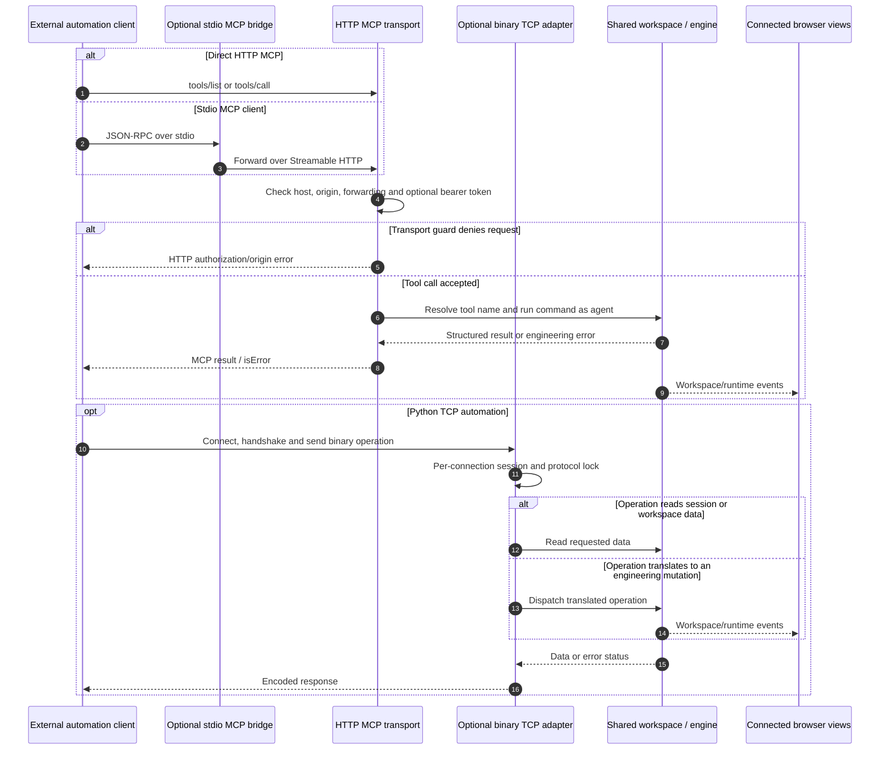

MCP provides structured tools, station/item resources, generated-program resources, screenshots and prompts. Screenshots require an active browser view. The stdio bridge retries a disconnected upstream connection once; it does not start a replacement application or maintain independent state.

TCP sessions have their own verb registry, handshake, run modes and connection state. They are an adapter over the engineering workspace, not another source of 283 model tools. The default listener is loopback-only on ports 20500–20502 when enabled.

## 9. Sequence: checks to controller-native output

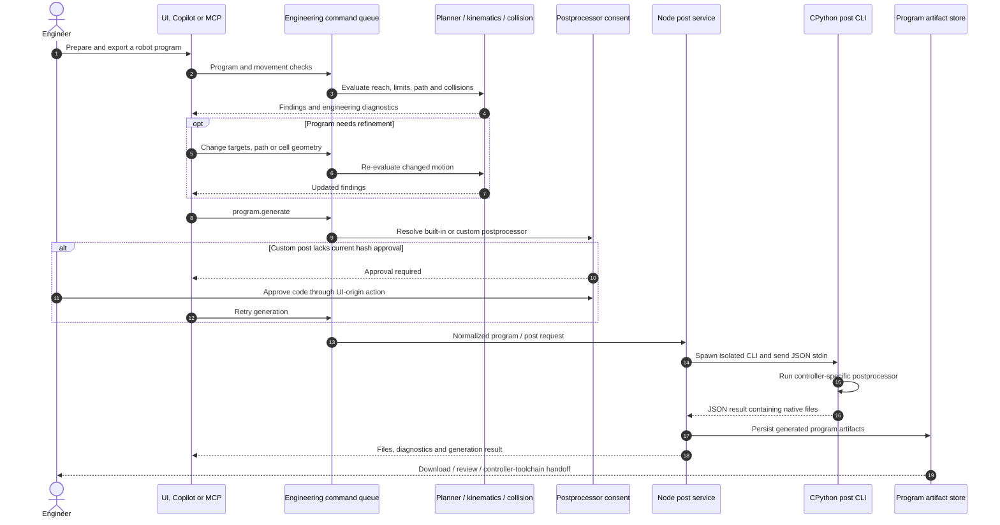

Validation and generation are composable operations: the recommended workflow checks before export, but the diagram must not be read as an unconditional safety interlock on every generation call.

The post CLI runs in a child process with a generation timeout. Native output targets controller families such as ABB, KUKA, FANUC and Universal Robots. Approved custom-code hashes are invalidated by code changes; approval is not equivalent to an OS sandbox or controller certification.

## 10. Sequence: photos and grounded research

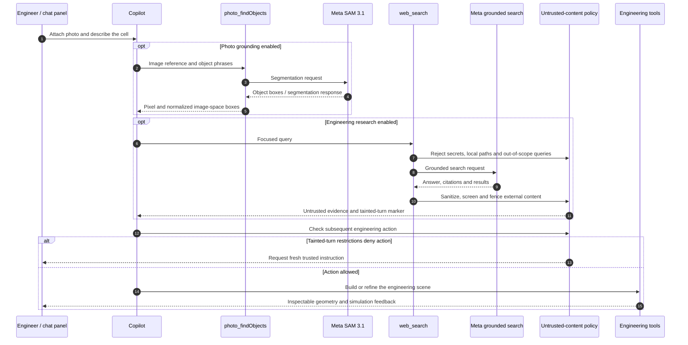

SAM results are **2D image-space evidence**, not measured 3D coordinates. Scale requires a reference; depth and physical placement remain assumptions to resolve through engineering inputs.

Web grounding and scope checks default to `muse-spark-1.2`; segmentation uses `sam-3.1`. Scope classification is model-based and can fail open when unavailable. Deterministic command checks, schema validation and untrusted-content restrictions are separate layers, not a claim that every injection can be detected.

## 11. Runtime services and data ownership

| Component | Responsibility and boundary |
| --- | --- |
| Workspace singleton | Authoritative stations, items, active station, revision and shared mutable state in one Node process |
| Dispatcher / `Tx` / `UndoGroup` | Validation, transaction-owned changes, rollback, patch creation and per-station undo |
| Motion planner / `Runner` | Instruction interpretation, path planning, limits, collision callbacks, waits, I/O and live motion |
| `rc_core` | FK/IK, geometry collision, robot definitions and binary station serialization |
| `rc_cad` | STEP/IGES geometry reconstruction and tessellation; a new WASM instance per import |
| Rapier runtime | Server-owned bodies, constraints, contact behavior and fixed-step simulation |
| QuickJS service | Async host bridge to engineering commands; bounded memory, time and call count; script undo macro and default rollback on failure |
| Python runner | Saved scripts, supervised child processes, managed environments and TCP callbacks into the workspace |
| Post service | Post discovery, custom-code consent, normalized generation requests and native program artifacts |
| File / backup services | Station files, recent files, backups, exports and persistence |
| Geometry store | Content-addressed triangle buffers on disk with an in-memory cache |
| Library / SimReady services | Catalog search, cached asset downloads and prepared physical assets |
| View bridge | Browser-assisted screenshots, view picking and UI dialogs |
| Decision services | Configurable external/local decision requests and execution |
| Simulation recorder | Captures simulation state for standalone browser-viewer export |
| Event delivery | Initial snapshots, revisioned patches, live joints, notifications and UI requests |

### Persistence and lifetime

| Data | Storage | Lifetime |
| --- | --- | --- |
| Workspace, undo stacks, listeners and execution queue | Server process memory | Reset by process replacement unless restored from saved files |
| Chat conversation histories | Server process memory, keyed by conversation ID | Not a durable conversation database |
| Settings and recent files | JSON files under the configured data directory | Depends on deployment storage |
| Geometry | Hashed `geometry/*.f32` files plus memory cache | Reusable across workspace reloads |
| Stations, backups and exports | Files under the data directory | Durable only with durable backing storage |
| Generated programs | Program artifact files; runtime resource cache | Files and cache have different lifetimes |
| Python scripts, environments and custom posts | Files and environment directories | Deployment/storage dependent |
| Code approvals | Hash-based consent records | Valid only for the approved code content |
| Browser workspace and live joints | Zustand and renderer memory | Rebuilt from server snapshots/events |

## 12. Deployment and trust boundaries

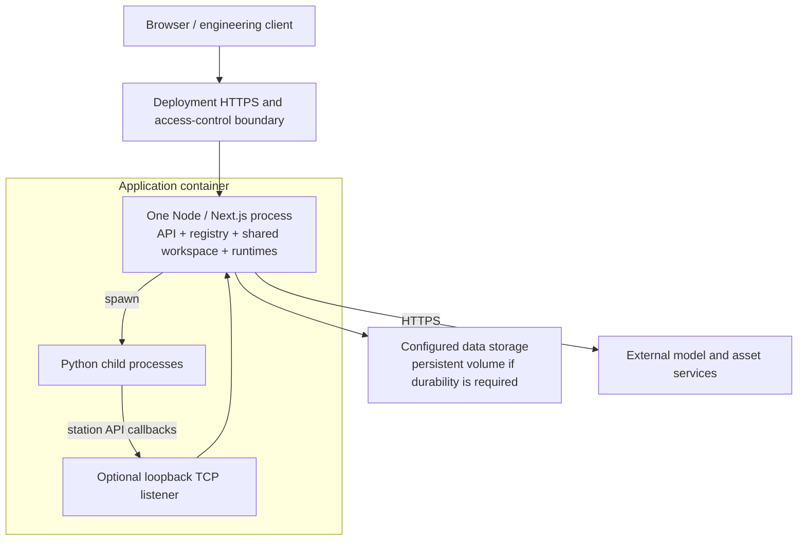

1. **Shared workspace, not multi-tenant sessions.** Browser views, Copilot and external tools operate on the same server workspace. Conversation IDs do not provide workspace isolation.
2. **MCP has a specific transport guard.** Loopback host/origin checks, forwarding checks and optional bearer authentication protect the MCP endpoint. They are not universal authentication for every HTTP route.
3. **Code approval is content-bound.** UI-origin approval and hashes gate sensitive Python/custom-post workflows. Origin tags alone are not authenticated user identities.
4. **Secrets are configuration, not artifacts.** Provider configuration and optional BYOK headers supply keys; public status/settings surfaces redact sensitive fields. Deploy over an appropriate HTTPS and access-control boundary.
5. **The shipped image uses one application process.** In-memory workspace state, listeners and chat histories do not support arbitrary horizontal replication without additional coordination.
6. **Filesystem durability is a deployment decision.** The container's temporary data location is ephemeral unless changed or backed by durable storage.
7. **The TCP listener is optional.** Its availability depends on configuration; container startup can disable it. It should not be treated as a public internet protocol.
8. **Simulation remains a software engineering check.** The application does not provide a hardware safety system or establish that a physical controller can be driven directly.

## Source map

| Architecture area | Authoritative code |
| --- | --- |
| Command contract and enumeration | [registry](../src/engine/registry.ts), [command registration](../src/engine/commands/index.ts) |
| Validation and transactional dispatch | [dispatcher](../src/engine/dispatch.ts), [transactions](../src/engine/tx.ts) |
| Shared state and host services | [server store](../src/server/store.ts), [service attachment](../src/server/services.ts) |
| Browser synchronization | [client API](../src/client/api.ts), [client store](../src/client/store.ts), [event stream](../src/app/api/events/route.ts), [poll fallback](../src/app/api/poll/route.ts) |
| HTTP command discovery and execution | [command catalog](../src/app/api/commands/route.ts), [command endpoint](../src/app/api/command/route.ts) |
| Copilot orchestration and policy | [agent](../src/server/agent.ts), [model configuration](../src/server/copilot/config.ts), [guardrails](../src/server/copilot/guardrails.ts) |
| Grounded perception and research | [vision](../src/server/copilot/vision.ts), [web search](../src/server/copilot/websearch.ts) |
| MCP tools and transports | [MCP server](../src/server/mcp/server.ts), [HTTP transport](../src/server/mcp/http.ts), [stdio bridge](../scripts/enginuity-mcp.mjs) |
| Binary automation transport | [TCP server](../src/server/rdkapi/server.ts), [connection sessions](../src/server/rdkapi/session.ts) |
| Motion and numerical kernels | [program runner](../src/server/runner.ts), [motion planner](../src/engine/sim/planner.ts), [WASM bindings](../src/engine/kinematics.ts), [core crate](../crates/rc_core/src/lib.rs) |
| CAD and physics | [CAD service](../src/server/cad.ts), [CAD crate](../crates/rc_cad/src/lib.rs), [physics runtime](../src/engine/physics/runtime.ts) |
| Python and native code generation | [Python runner](../src/server/python-runner.ts), [Python environments](../src/server/python-env.ts), [post service](../src/server/post.ts), [post CLI](../python/robocraft_post/cli.py) |
| Scripting and persistence | [QuickJS sandbox](../src/server/scripts/sandbox.ts), [script services](../src/server/scripts/index.ts), [file store](../src/server/fileStore.ts), [backups](../src/server/backup.ts) |
| Assets and exported simulation | [asset service](../src/server/simready/service.ts), [simulation recorder](../src/server/simRecorder.ts), [standalone viewer](../src/viewer/simViewer.ts) |
| Deployment | [container definition](../Dockerfile), [application scripts](../package.json) |
